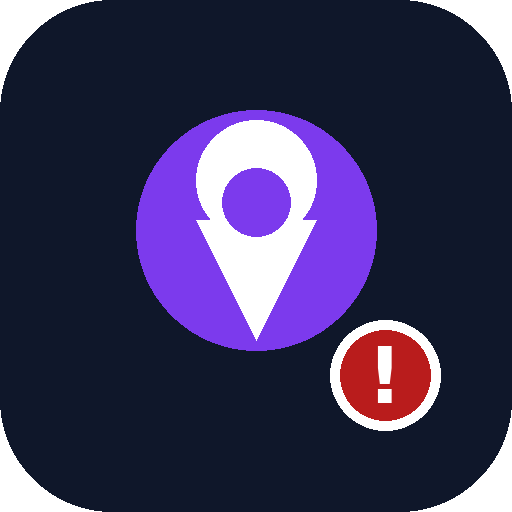

Orienta
=======

<p align="center">
  
</p>

Introducción
------------

Orienta es una aplicación móvil de mapa virtual con opciones orientadas a personas ciegas y con discapacidad visual, desarrollada durante la hackatón por Cristóbal Hernández, Danko Vera y Esteban Parra.

La idea original se planteó como un "mapa de movilización" por capas. Durante la jornada el equipo eligió el nombre "Orienta".

Propósito
---------

- Asistir a personas no videntes en entornos específicos.
- Permitir la ubicación y navegación en lugares como universidades, instituciones y estaciones de metro.
- Ofrecer indicaciones por voz y recursos accesibles para que la persona pueda orientarse de forma autónoma.
- Conectar a personas videntes y no videntes en un mismo mapa para apoyarse mutuamente.

Integrantes y roles
-------------------

- Cristóbal Hernández — desarrollo del código: sistema GPS, tracking en primer y segundo plano, geofences, triangulación, integración frontend/backend, deploy y PWA.
- Danko Vera — prototipo del mapa, diseño de interfaces (videntes y no videntes), UI de edificios, generador de rutas y legibilidad de opciones.
- Esteban Parra — documentación, README, búsqueda de nombres e ideas de logo.

Declaración de funciones registrada en la reunión inicial (9:32):
- El equipo usa Expo y React Native.
- Cristóbal desarrolla el código.
- Danko realiza el prototipo del mapa.
- Esteban realiza el readme.

Funcionalidades
---------------

- Mapa virtual por capas con información territorial y de movilización.
- Botón central de ayuda que solicita asistencia a personas videntes cercanas.
- Explicación por voz para personas no videntes.
- Botón que indica en qué lugar se encuentra la persona en un momento exacto.
- Centralizado de la ubicación actual con zoom adaptable (interior / exterior). (prototipo funcional)
- Cambio automático de ruta cuando un camino está bloqueado.
- Visualización de personas no videntes en el mapa de los usuarios videntes.
- Sistema de ubicación combinado: GPS por satélite + triangulación entre dispositivos.
- Interfaces diferenciadas para usuarios videntes y no videntes.
- Botones por defecto para buscar edificios de forma intuitiva.
- Geofencing y seguimiento en segundo plano.
- Exportación de puntos y rutas a GeoJSON con textos accesibles en español.
- Datos de velocidad y movimiento agrupados bajo un icono extensible para no sobrecargar la pantalla.
- Diseño responsive para distintos dispositivos.
- Logo de presentación al abrir la aplicación.
- Instalación como Progressive Web App (PWA).

Tecnologías
-----------

- Expo y React Native (TypeScript).
- expo-location, expo-task-manager y react-native.
- Metro (bundler de React Native).
- Progressive Web App (PWA), instalable desde el navegador (recomendado Google Chrome).
- GPS por satélite y triangulación entre dispositivos móviles.
- API de vibración del dispositivo.
- Geofencing y tracking en primer plano / segundo plano.
- GeoJSON para el intercambio de puntos y rutas.
- Netlify para pruebas de deploy en dispositivos móviles.
- Lectores de pantalla y textos accesibles en español.

Recursos e IA usadas
--------------------

- ChatGPT: generación de ejemplos e ideas de logos y apoyo en documentación.
- Gemini (lo mismo que chatgpt).
- Claude(Realizando interfaces iniciales).
- OpenCode en Warp, utilizando el modelo Big Pickle.
- Documentación de Expo / React Native como referencia técnica.

Instalación y ejecución
-----------------------

Uso como PWA (forma principal):

1. Ingresar a la URL del deploy desde Google Chrome (navegador recomendado).
2. Abrir el menú del navegador y elegir "Agregar a pantalla de inicio" o "Instalar aplicación".
3. Abrir Orienta desde el ícono recién instalado.
4. Aceptar los permisos de ubicación cuando el navegador los solicite.
5. Utilizar el botón central para conocer la ubicación actual o pedir ayuda.

Desarrollo local (según la documentación del módulo backend):

1. Instalar dependencias con npm install.
2. Configurar app.json con los permisos de ubicación y la integración correspondiente.
3. Ejecutar npx expo start.
4. Abrir el proyecto en Expo Go, en un dispositivo o generar la versión web/PWA.

Estructura del proyecto
-----------------------

Estado actual de los archivos versionados en el repositorio:

```text
backend/.gitkeep
documentacion/.gitkeep
documentacion/mapa-de-movilizacion.md
front/.gitkeep
```

Estructura planificada del backend (según las notas de la hackatón):

```text
backend/
├── README.md          # instalación, app.json, integración con Metro y ejemplos
├── package.json       # peerDeps: expo-location, expo-task-manager, react-native
└── src/
    ├── index.ts       # exports públicos
    ├── types.ts       # GpsPoint, MovementSample, MovementStats, GeofenceRegion, etc.
    ├── constants.ts   # nombres de tareas, límites y defaults
    ├── permissions.ts # foreground/background + openLocationSettings()
    ├── movement.ts    # Haversine, rumbo, MovementTracker, filtro por precisión
    ├── tracker.ts     # startForegroundTracking()
    ├── tasks.ts       # defineTask de background y geofencing (scope raíz)
    ├── background.ts  # startBackgroundTracking(), startGeofencing(), stop...
    ├── events.ts      # backgroundLocations / geofenceEvents
    └── geojson.ts     # GeoJSON + textos accesibles en español
```

Funciones expuestas por el módulo de seguimiento:

- startForegroundTracking() → emite MovementSample y expone getStats() / getPoints().
- startBackgroundTracking() / stopBackgroundTracking().
- startGeofencing() (alias updateGeofences) / stopGeofencing().
- Suscripciones: backgroundLocations.subscribe(...), geofenceEvents.subscribe(...).
- Salidas para la interfaz: pointsToFeatureCollection(), routeToFeature() (LineString), movementStatsToText() y geofenceEventToText() para lectores de pantalla.

Pruebas realizadas
------------------

- 10:19 — Primer test del backend: el GPS funciona en consola; la página mostraba "empty". Estado: OK.
- 10:44 — Primer test del frontend: mapa operativo con indicaciones, pero en inglés y poco intuitivas. Estado: a mejorar.
- 10:57 — Segundo test del backend: velocidad del usuario no se actualizaba. Estado: OK con observación.
- 11:22 — Primer deploy: usuario y mapa visibles; el usuario desaparecía al activar el GPS. Estado: OK con observación.
- 11:57 — Triangulación: los usuarios videntes ven a los no videntes; faltaba triangular entre usuarios. Estado: OK.
- 12:17 — Detectado: iPhone no funcionaba correctamente.
- 12:25 — Prueba física con dos dispositivos: el movimiento ocurría en sentido contrario. Corregido.
- 12:46 — Sistema de ubicación probado con éxito. Estado: ÉXITO.
- 14:31 — Error: la petición de ayuda no llegaba a personas videntes cercanas. Corregido.
- 15:10 — Error: movimiento invertido del usuario no vidente. Corregido.
- 15:20 — Error: usuario no vidente se congelaba al entrar a un edificio. Corregido.
- 15:40 — Error: el usuario no vidente viajaba más distancia de la debida. Corregido.

Estado actual
-------------

Según las notas finales de la jornada, el código quedó "completo" y se iniciaron las pruebas finales, el pitch y la presentación. Quedan registrados como aprendizados los ajustes de sincronía, navegación en interiores y precisión de distancia.

Documentación adicional
-----------------------

- documentacion/mapa-de-movilizacion.md — propuesta del mapa por capas con herramientas para personas con problemas de visión.

Requerimientos del README
-------------------------

[x] propósito
[x] integrantes
[x] ejecución
[x] funcionalidades
[x] tecnologías
[x] recursos e IA usadas
